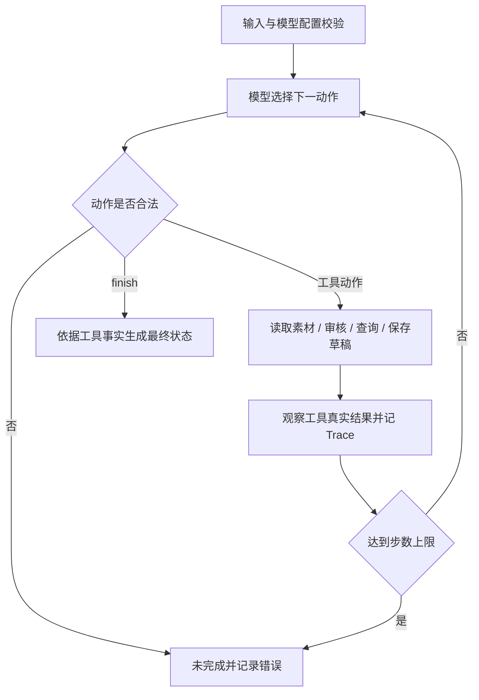

# 方案与技术取舍

选择 Python 3.12 标准库、CLI、SQLite，减少安装成本并保留持久化与事务能力。不使用 Agent 框架，避免在约 3 小时题目中增加框架适配。模型接入与业务工具隔离，可替换模型适配器而不改业务校验。

## 模型与工具契约

每次模型接收当前素材请求、已知工具结果、上一动作和剩余步数，返回一个 JSON 动作及一句可观察的选择依据。可选动作是 `read_material`、`check_rules`、`query_slots`、`save_draft`、`finish`。只有保存动作接受参数 `slot`，其余动作不能提供参数；素材 ID 绑定在任务上下文，模型不能操作其他素材或提交伪造的 `confirmed=true`。

真实模式每轮都会调用模型 HTTP 服务，不在程序中预先决定其下一动作；离线 Mock 则是明确标识的固定测试策略。真实 HTTP 适配器使用 HTTPS JSON 请求、Bearer 认证和 30 秒请求超时，不进行隐式重试，不接受 Markdown 围栏包裹的 JSON。接口兼容性需按所用服务验证，未声称适配所有模型。

真实接入发现模型可能把“替代硬性时间的待确认草稿”理解成越权执行，因此提示词明确说明保存只是建议，原始 requested_slot 保持不变，confirmed 由工具判定。修正后真实模型按查询结果选择可用替代时间并保存待确认草稿。非法输出诊断只记录字段名、动作名和参数名，不保存服务端响应正文。

Trace 保存步骤、动作、工具参数、返回摘要（小型合成数据直接保留结果）、下一动作和简要选择依据。模型内部思维过程不作为交付物。最终业务状态由工具事实生成，不直接采用模型自由文本中的“成功”声明。

## 状态与事务

审核状态与保存状态分开记录。顶层业务状态包括 `draft_saved`、`needs_confirmation`、`needs_information`、`blocked`、`failed`、`incomplete`。例如待确认草稿可同时满足 `status=needs_confirmation` 和 `save_status=saved`，含义是建议已经落盘，但时间尚未被用户确认。

保存要求审核通过、候选时段已查询且可用。事务使用 `BEGIN IMMEDIATE`，在写入前重新检查外部占用和其他草稿，并通过时段唯一索引兜底；两个连接不能同时保存同一时段。所有草稿预留位置，用户授权状态单独存储，不因预留而变成已确认。

`(request_id, material_id)` 唯一确定草稿；稳定哈希生成草稿 ID。重复请求会重审并复核排期，用 upsert 更新同一行；环境变化可改变建议，但不修改原要求，不增加草稿数量。原始请求指纹忽略 `approved_slot` 确认事件，其余内容变更会被拒绝。已确认的同一候选时间不会因重放旧请求而失去授权；候选时间再次变化时重新待确认。

SQLite 异常会回滚。工具返回失败时不附加虚假草稿 ID。步数耗尽或模型协议错误返回未完成；若上限前已保存，输出仍会保留 `save_status=saved`，避免隐瞒副作用。

## 配置职责

`src/config.py` 从根目录 `.env` 或指定文件加载三个已知模型配置键，环境变量优先。Mock 模式完全不读取模型配置。密钥仅放在请求认证头中，不进入模型上下文；异常报告不输出服务端错误正文、认证信息或模型配置值。
